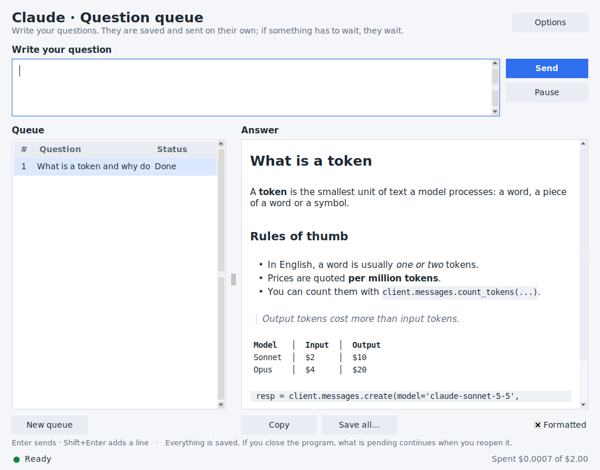
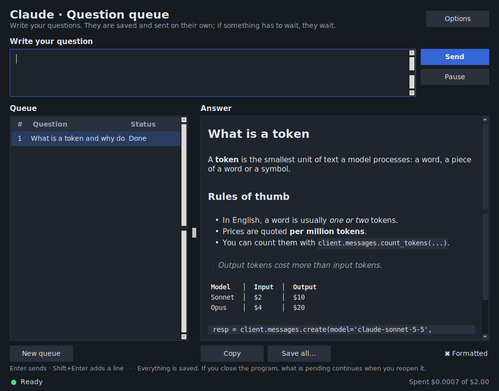
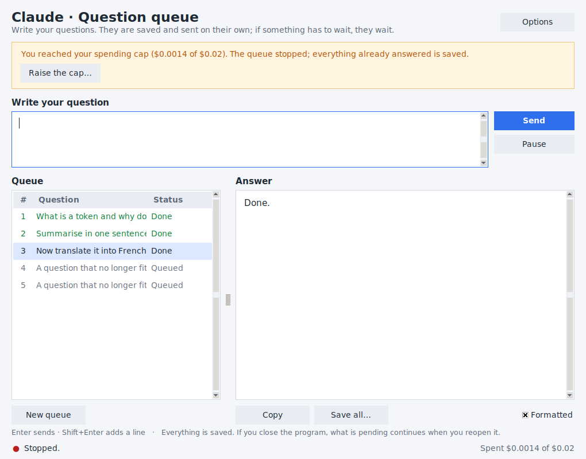
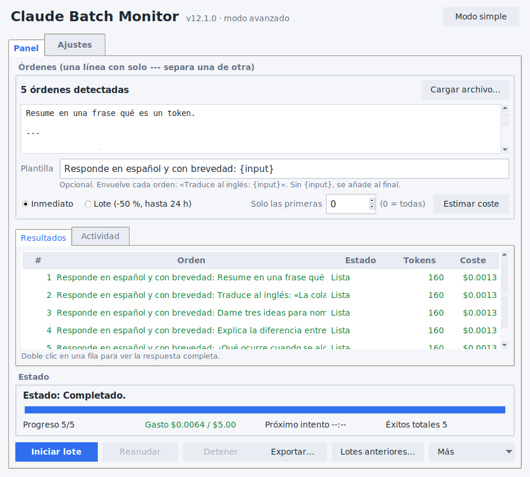
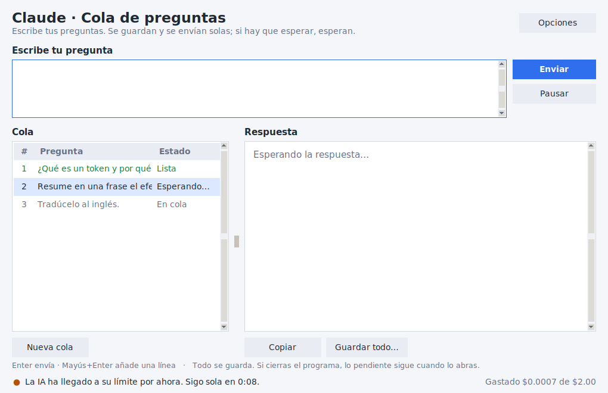

# Claude Batch Monitor

**A desktop queue for Claude.** Type your questions; the app sends them one by one, **waits by itself** when the API says "slow down" (rate limit, overloaded servers, no internet) and carries on exactly where it stopped — behind a **hard spend cap**, so a long run can never surprise you with the bill.

<p align="center">
  
</p>

> Personal project by [Samuel Pil](https://github.com/Pil-08) (not client work). Screenshots use a simulated API; no real requests were made to take them.

## The easy way: one file

1. Install [Python 3.9 or newer](https://www.python.org/downloads/). Windows and macOS: leave *tcl/tk* ticked. Debian/Ubuntu: `sudo apt install python3-tk`.
2. Download **[`claude_batch_monitor.py`](claude_batch_monitor.py)**: that single file *is* the whole program (on GitHub, open it and press *Download raw file*).
3. **Windows:** double-click it. **macOS / Linux:** run `python3 claude_batch_monitor.py` in a terminal.
4. The first time, it offers to install the one library it needs (`anthropic`, from PyPI) with a button. Then paste your API key, type a question and press Enter.

It is plain, readable Python: open it in any editor. A table of contents at the top lists the numbered sections. There is no installer, no packing and no hidden step. *(Optional, Windows: rename it to `claude_batch_monitor.pyw` so no console window opens next to the program.)*

You need an **Anthropic API key** (pay-per-use, from [platform.claude.com](https://platform.claude.com)). The first-run screen walks you through it; a few dollars are enough for hundreds of questions.

> **API vs. subscription.** This program uses the *Anthropic API*. It cannot see or use the limits of a claude.ai Pro/Max plan or of Claude Code's subscription — those are a different system with their own quotas. The "limit" it handles is the API's own (requests/tokens per minute, monthly spend tier, your credit balance).

## What it does

- **Simple mode** for anyone: paste your API key once, type a question, press Enter. Answers stream in live, **formatted** (headings, lists, code, tables); questions pile up in a queue that survives closing the program. Light and dark themes.
- **Waits instead of failing.** Per-minute limit → waits for the exact time the API asks. Server overloaded → backs off and retries. No internet → keeps trying for up to 10 minutes. Closing the app mid-queue → the pending questions are still there next time.
- **Stops instead of overspending.** Before every request it estimates the *worst case* and refuses to send it if it would cross your cap. A response that was already paid for is **always saved first**, even if it is the one that hits the cap.
- **Never pays twice for the same thing.** A connection that drops mid-response, a request that times out, a batch whose creation went unanswered: the program stops or looks first, it never just sends again. A batch is not created twice, even if you close the program in the middle of sending it: before sending another it looks for the one that may already exist.
- **Says why it stopped** when waiting cannot help: out of credit, the account's monthly spend limit (with the date access returns), a rejected key, a model that no longer exists — each with the button that fixes it.
- **Advanced mode** for bigger jobs: load a `.csv` / `.tsv` / `.jsonl` (one order per row, pick the column), wrap every row in a template, use the **Batches API at half price**, run requests in parallel, estimate the cost first, see/copy/export every answer, resume old batches, loop with a deadline, Telegram and desktop notifications, system-tray background mode.
- **Command line** (`--cli`) for servers and cron, with meaningful exit codes and `--json` output.

<p align="center">
  
  &nbsp;
  
</p>
<p align="center">
  
  &nbsp;
  
</p>

## What it does on your computer (and what it does not)

- **Network.** Your questions go to `api.anthropic.com`, through the official `anthropic` library. Nothing else — except Telegram messages (`api.telegram.org`) if *you* set up Telegram alerts, and the download of `anthropic` from PyPI if *you* accept the first-run install. No telemetry, no analytics, no update checks, no accounts. Links (billing console, docs) open in your browser only when you click them.
- **Files.** Settings, the queue, answers and a log live in the program's own data folder (see *Safety*). The API key goes to the system keyring when there is one; it is never written to a file or to the log.
- **Other programs it starts.** `pip install anthropic` (only if you accept); `systemd-inhibit` / `caffeinate` (Windows: one Win32 call) to keep the computer awake while it works; `xdg-open` / `open` / `os.startfile` to open a folder when you press the button; `defaults` / `gsettings` (Windows: the registry) to read whether your system uses a dark theme.
- **No hidden code.** The file contains no `exec`, `eval`, `compile` of strings, nothing decoded and nothing decompressed. A test checks that on every build, and another one checks that the only web addresses in the file are the ones listed above.
- **You can verify it.** `python tools/build_single_file.py --check` regenerates the single file from the modules in `claude_batch_monitor/` and tells you if the two differ.

## Other ways to get it

**Download an app** (no Python needed): the [Releases](../../releases) page has a Windows `.exe`, a macOS `.zip` and a Linux binary.
They are not code-signed, so Windows SmartScreen / macOS Gatekeeper will warn you the first time (*More info → Run anyway* / right-click → *Open*).

**From the repository** (to read, change or contribute):

```bash
git clone https://github.com/Pil-08/claude-batch-monitor
cd claude-batch-monitor
pip install -e ".[all]"        # [all] adds keyring, system tray and desktop notifications (all optional)
python -m claude_batch_monitor # same program, run from the modules
```

## Using it

| | |
|---|---|
| **Simple mode** | `python3 claude_batch_monitor.py` — type, press **Enter**, done. *Shift+Enter* adds a line. *Options* has the model, instructions for every answer, spend cap, language and theme. |
| **Advanced mode** | `python3 claude_batch_monitor.py --avanzado` (or *Options → Advanced mode…*). Switch back with *Modo simple*. |
| **Command line** | `python3 claude_batch_monitor.py --cli --help` |

(On Windows write `py` instead of `python3`. With the pip install, `python -m claude_batch_monitor` and `claude-batch-monitor` do the same.)

```bash
# What would this cost? Nothing is sent.
python3 claude_batch_monitor.py --cli --mensaje datos.csv --campo texto --plantilla "Summarise: {input}" --dry-run

# Try the first 2 rows, then run everything at half price with a $3 cap and export the results
python3 claude_batch_monitor.py --cli --mensaje datos.csv --campo texto --plantilla "Summarise: {input}" --limit 2
python3 claude_batch_monitor.py --cli --mensaje datos.csv --campo texto --plantilla "Summarise: {input}" \
    --modo lote --tope-gasto 3 --exportar resultados.csv

# Pick up an interrupted run
python3 claude_batch_monitor.py --cli --listar
python3 claude_batch_monitor.py --cli --reanudar 1a2b3c4d

# A batch keeps running (and billing) on Anthropic's side if you just stop waiting: cancel it
python3 claude_batch_monitor.py --cli --cancelar-lote 1a2b3c4d
```

Exit codes: `0` done · `1` failure/network · `2` spend cap · `3` no credit / account limit · `4` incomplete (stopped or deadline) · `5` bad usage, or another copy of the program is already running.
*The command-line flags and the advanced window are in Spanish for now; the simple mode is bilingual.*

## Safety

- **Spend cap on by default** ($2 in simple mode, $5 elsewhere; `0` disables it). Prices come from a built-in catalogue, the unknown-model fallback is the *expensive* price, and you can override them.
- **Your key never touches a file.** It lives in the OS keyring (or an environment variable, or memory for the session) — never in `config.json`, the repo, logs or exports. It is sent only to Anthropic.
- **Everything is on your disk:** `%APPDATA%\ClaudeMonitor` (Windows), `~/Library/Application Support/ClaudeMonitor` (macOS) or `~/.config/ClaudeMonitor` (Linux); override with `CLAUDE_MONITOR_HOME`. Finished batches are removed after 30 days; batches with pending work never are.
- **No duplicate charges:** if the connection drops *mid-response* it stops instead of resending, because the server may already have billed that request. A request that timed out after being sent counts against the cap as possible spend. Creating a batch is written down *before* it is attempted, and before any retry the account's later batches are searched for the one that may already exist. Checks that cost nothing (a batch's status, the list of batches, downloading results) are simply retried when the connection drops.
- **One copy at a time** per data folder (a second window or terminal run is refused): two copies would overwrite each other's running spend total and the cap would stop protecting you.
- **A full or read-only disk stops the run at once**, and the answers you already paid for stay on screen (copy / export) until they can be written.
- **Spreadsheet-safe CSV:** text cells that start with `=`, `+`, `-` or `@` are prefixed with an apostrophe so Excel/Calc do not run them as formulas.

## Status

Beta. What has been tried: 1,480 automated tests, including the real `anthropic` SDK (0.69 and 1.x) against a **simulated Anthropic server over real sockets** — rate limits, 5xx, cut and reset connections, empty and truncated streams, timeouts, a full disk, closing the program in the middle of sending a batch — plus seeded random failure runs, property-based tests, and real processes (`kill -9`, Ctrl+C, two copies at once, the single file and the package both). All of it passes on Python 3.9, 3.10, 3.11, 3.12 and 3.13, and the same suite also runs against the single file. What has **not** been done: long runs against the live API; the Windows/macOS executables are built by CI but not hand-tested, nor is the single file on those systems; the windows were only exercised under a virtual display on Linux.

Known limits, stated plainly:
- If a connection drops *after* the server processed a request, that one request may be billed without the program ever seeing it (it stops and says so).
- A request abandoned after a timeout counts as possible spend for the rest of *that run*; closing and reopening the program forgets it (Anthropic's invoice is the reference).
- Before sending a batch the program notes the newest batch in your account, and looks for its own only among later ones. If that look-up could not be read at sending time, it falls back to dates and trusts this computer's clock to be within ten minutes of Anthropic's. A batch the server is still in the middle of creating at that very moment cannot be seen, which is why a retry waits first.
- If the program is killed at the very instant it writes a checkpoint while collecting a big batch, the running spend total can count up to 5 % of that batch twice (always high, never low).
- Anthropic's own docs note a batch can go slightly over a workspace spend limit, so this program's cap is checked *before* sending, with the worst case of the whole batch; and the cap counts what this program sent, not other tools using the same key.
- CSV exports prefix cells that start with `=`, `+`, `-` or `@` with an apostrophe (spreadsheet safety); a program reading the answers should use the JSONL export, which is unmodified.

Start with `--limit 2` (or *Solo las primeras 2* in advanced mode) before pointing it at a big file. See [REVIEW.md](REVIEW.md) for what changed from the original single-file script and why, [CHANGELOG.md](CHANGELOG.md), and [docs/ROADMAP.md](docs/ROADMAP.md) for similar projects and the ideas they suggest.

## Develop

```bash
pip install -e ".[all]" pytest hypothesis ruff
ruff check .
xvfb-run -a python -m pytest                       # everything, about 5 minutes (window tests need a display; on a desktop: python -m pytest)
xvfb-run -a python -m pytest -m "not simulacro"    # the quick part: skips the simulations (simulated server, real processes)
CBM_ARCHIVO_UNICO=1 xvfb-run -a python -m pytest   # the same tests, against claude_batch_monitor.py
python tools/build_single_file.py                  # regenerate the single file after editing a module
```

The simulations (`tests/servidor_falso.py`) run the real `anthropic` SDK against a small local server that fails on request: add `[[plan:429(2),529,ok]]` to a question and the server answers it with a rate limit, then an overload, then a real answer. That is how new failure modes get a test.

Build the executable for your OS (`pip install pyinstaller`, then `pyinstaller packaging/claude-batch-monitor.spec`); tagging `v*` builds all three on GitHub Actions and opens a **draft** release.

```
claude_batch_monitor.py     the whole program in one file (generated: this is what you download)
claude_batch_monitor/       the same program as modules (edit these, then regenerate)
  core/        engines: immediate (one request per order) and batch (Messages Batches API), error policy
  gui/         simple mode, advanced mode, dialogs, tray, formatting, themes, i18n
  cola.py      the simple-mode queue (thread + events, no windows)   ejecutor.py   same, for one batch
  cli.py  config.py  job.py  pricing.py  estimator.py  inputs.py  export.py  notify.py  claves.py  instalacion.py …
tools/         build_single_file.py joins the modules into the single file
tests/         pytest suite (window tests are skipped without a display)
packaging/     PyInstaller spec, launcher and icons
```

## License

[MIT](LICENSE) © Samuel Pil. Not affiliated with Anthropic. "Claude" is a trademark of Anthropic.
